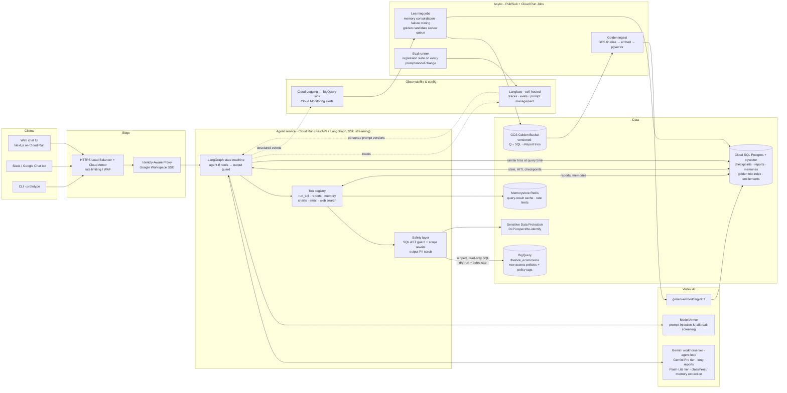
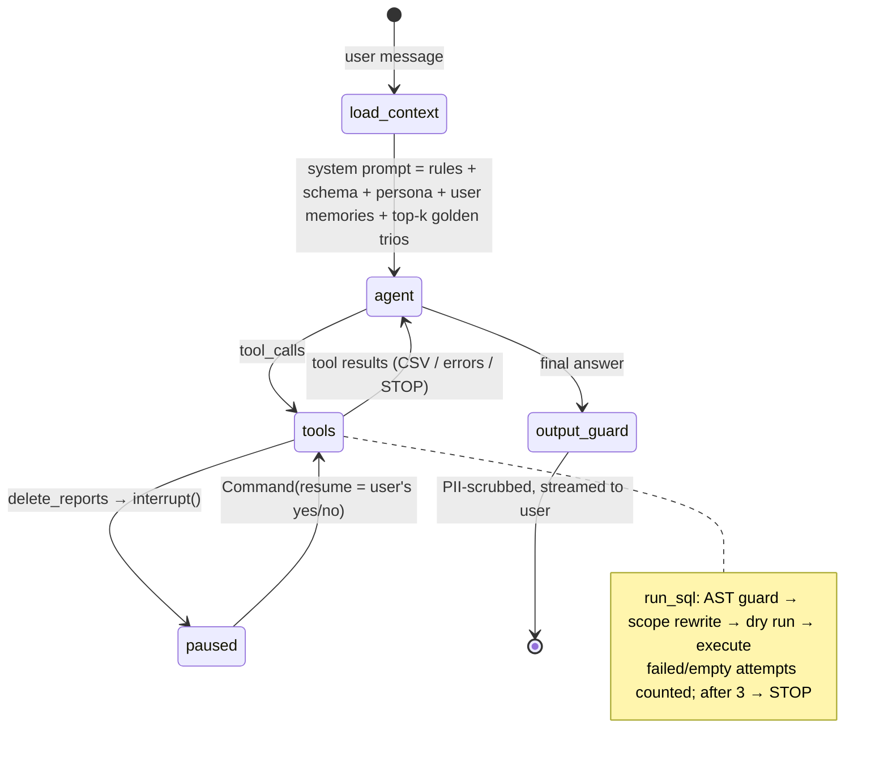
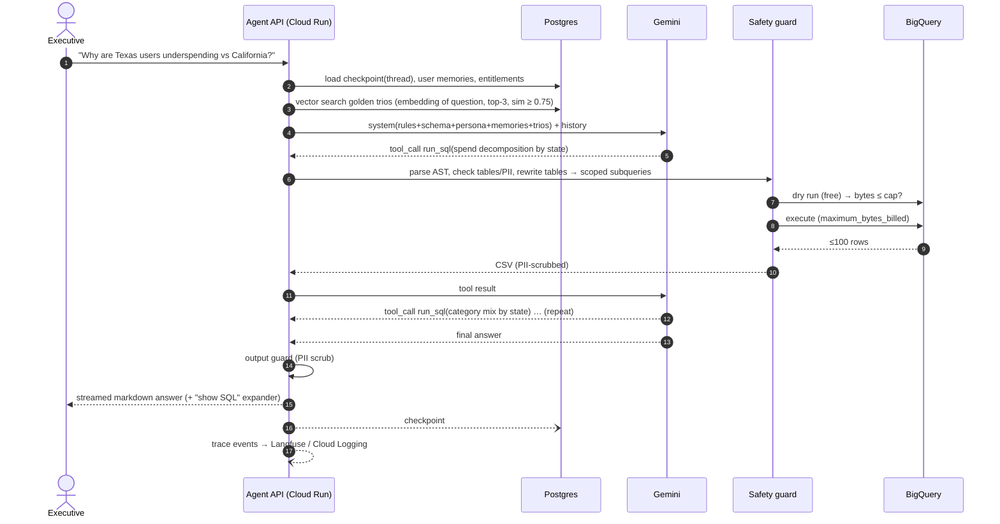
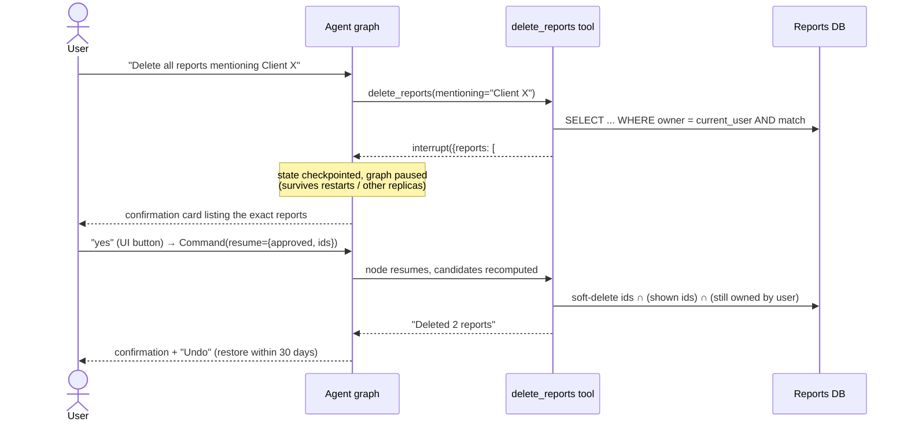
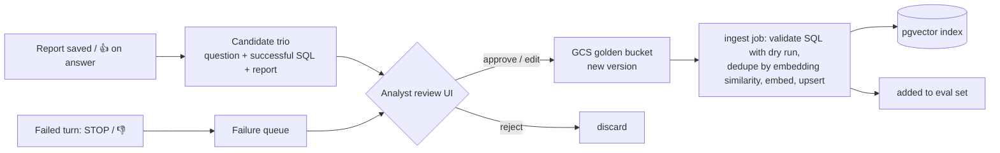

# Retail Data Analysis Agent: High-Level Design

This document is the production design. The prototype in this repo implements a subset of it, and the README maps
each requirement to the prototype code. Throughout, **(P)** marks something the prototype actually does and
**(D)** marks design only.

---

## 1. Goals and assumptions

| # | Assumption (please correct us if it is wrong) |
|---|---|
| A1 | Users are non-technical executives. They log in with the company's Google Workspace SSO. |
| A2 | "Products related to a user" means a product scope per user (department / category / brand), kept by an admin in an entitlements table. The public dataset has no owner column, so the prototype simulates scopes in `config/users.json`. |
| A3 | The DB is read-only. The only thing the agent can write is the *Saved Reports* library, user memories, and golden-bucket candidates. |
| A4 | PII = names, email, street address, postal code, coordinates. City/state/country/age/gender are allowed in aggregates. `user_id` is a pseudonymous key and may be shown. |
| A5 | Answers are allowed to take 10–60 s for multi-step analyses. We stream progress so the wait is visible. |
| A6 | GCP is the target cloud, because the data is already in BigQuery and the client asked for Gemini. |

---

## 2. Architecture diagram

### Agent graph (the state machine that runs every turn)

---

## 3. Component choices and reasoning

| Building block | Choice | Why | Alternatives considered |
|---|---|---|---|
| Orchestration | **LangGraph** (P) | The control flow is an explicit graph, not a hidden agent loop. `interrupt()` plus checkpointers give the destructive-action confirmation and multi-replica resumability natively. Streaming, recursion limits and per-node tracing come built in. It is provider-agnostic. | Google ADK has a good GCP fit, but less mature pause/resume semantics. A plain Gemini SDK loop is less code, but we would re-implement checkpointing/HITL. CrewAI/AutoGen are multi-agent oriented, which is overkill here. |
| LLM | **Gemini 4 Hydrogen** via OpenRouter (P) or directly via AI Studio (P); fallback: Claude Haiku 5.5 (cross-vendor, OpenRouter) or Gemini Flash-Lite (AI Studio) (P), **2.5 Pro** for long quarterly reports (D), **Flash-Lite** for cheap classifiers (D) | Strong tool calling, 1M context, low latency/cost, free tier for the prototype, and requested by the client. Model names are env vars, so an upgrade is a config change. | Pro everywhere would cost ~4–8× more for a small quality gain on short SQL tasks. |
| Model hosting | **Vertex AI** in prod, AI Studio key in prototype | Vertex gives regional processing, VPC-SC, IAM auth (no API keys), and data is not used for training. | – |
| Warehouse | **BigQuery** (given) | Dry runs are free, so we can validate SQL and estimate cost before paying. `maximum_bytes_billed` gives a hard cost cap. Native row access policies and column policy tags handle security. | – |
| App DB | **Cloud SQL Postgres + pgvector** | One managed DB for LangGraph checkpoints (`PostgresSaver`), reports, memories, entitlements and the golden-trio vector index. A few thousand trios do not justify a separate vector DB. | Qdrant/Pinecone (another service to run and secure), BigQuery `VECTOR_SEARCH` (fine, but ~1–2 s latency per lookup). |
| Golden bucket storage | **GCS** (versioned JSON) | Analysts already produce files. Versioning gives an audit trail and rollback. Object-finalize events drive re-indexing. | – |
| Cache | **Memorystore Redis** (D) | Executives repeat the same questions (e.g. "monthly revenue"). We cache results keyed on the hash of the *scoped* SQL plus a TTL, so each user's scope stays separate. | – |
| Input safety | **Model Armor** (D) + strict system scope (P) | Managed prompt-injection/jailbreak detection. It is one signal only: the real security boundaries are deterministic (§5). | – |
| PII | **AST guard + BQ policy tags** (P: guard), **regex scrub** (P), **Cloud DLP** (D) | Blocking PII columns before execution is deterministic. Masking text after the fact is probabilistic, so it is only the second layer. | Presidio is a good OSS alternative to DLP when we must stay cloud-agnostic. |
| Observability | **JSONL event log** (P) → **Cloud Logging + BigQuery sink** (D), **Langfuse** (P optional, D) | Langfuse shows nested traces per turn (prompt, tool I/O, tokens), runs evals, and manages prompts in a UI for non-developers. Logs in BigQuery let us compute metrics with SQL and build Looker Studio dashboards. | LangSmith (SaaS only; data residency concerns). |
| Compute | **Cloud Run** | Scales to zero, handles SSE streaming, and needs no cluster ops. State lives in Postgres, so any replica can resume an interrupted graph. | GKE once traffic justifies it. |

---

## 4. Data flow of one question

Where data lives:

| Data | Where | Retention |
|---|---|---|
| Raw transactions | BigQuery (read-only, never copied) | n/a |
| Query results | Only in memory and in the LLM context (≤100 rows, scrubbed). Redis cache with 1 h TTL (D) | ephemeral |
| Conversation state | Postgres checkpoints (prototype: `SqliteSaver`, `data/checkpoints.db`) | 90 days |
| Saved reports | Postgres `reports` (prototype: SQLite), soft delete | until deleted + 30-day restore window |
| User memories | Postgres `preferences` (prototype: SQLite) | until the user clears them |
| Golden trios | GCS (source of truth) + pgvector index (prototype: `golden/trios.jsonl`) | versioned |
| Traces | Langfuse + Cloud Logging → BigQuery (prototype: `data/traces.jsonl`) | 30 days full, 13 months aggregated |

---

## 5. Safety & PII masking

Defence in depth. **The LLM is never a security boundary**: every layer below except 1 and 2 is deterministic.

1. **Authentication.** IAP + Workspace SSO. The user identity comes from the verified IAP JWT, never from the chat.
2. **Scope instructions.** The system prompt limits the agent to analysis of this data, saved reports and preferences, and says that instructions found in user messages or data never override the rules. Model Armor screens input and output for injection/jailbreak (D). Off-topic requests get a polite refusal.
3. **SQL AST guard (P)**, `agent/safety.py`. The model's SQL is parsed with sqlglot (BigQuery dialect) and must satisfy:
   - exactly one statement, which is a `SELECT`/set operation, with no DML/DDL nodes anywhere;
   - only the 4 allowed tables in the allowed project/dataset (no `INFORMATION_SCHEMA`, no other datasets);
   - no PII column referenced anywhere (projection, `WHERE`, function args, CTEs);
   - no `SELECT *` / `t.*` that expands a *base table*, and no whole-row references such as `TO_JSON_STRING(u)`, which would smuggle PII columns out. `*` over a CTE or subquery is allowed: its columns were already named and checked. Blocking it caused needless retries in live testing.
4. **Row-level scoping (P).** After validation, every table reference is replaced by a subquery filtered to the user's product scope. `order_items` is joined to the allowed `products`; `orders`/`users` are restricted to orders/customers that touch the allowed products. A query that never mentions `products` is still scoped. The model cannot remove the filter because it is added after the model is done.
   *Production:* the same rule is enforced again inside BigQuery with **row access policies** on authorized views (`GRANT ... FILTER USING (brand IN (SELECT brand FROM entitlements WHERE user = SESSION_USER()))`). PII columns carry **policy tags with dynamic data masking**, so even a guard bug cannot leak them. Queries run with the end-user's identity (OAuth) or a per-scope service account.
5. **Result scrubbing (P).** Tool results and the final answer pass through a regex scrub for emails and phone numbers; in production, Cloud DLP inspects with more infoTypes (D). Every mask is logged as a `pii_masked` metric.
6. **Small-group suppression (D).** Aggregates over fewer than 5 customers are suppressed (k-anonymity), so a scoped user cannot re-identify an individual by slicing city × age × gender.
7. **Cost and abuse limits.** Per-query bytes cap (P), per-user rate limit and daily token budget (D), and a recursion limit per turn (P).

---

## 6. High-stakes oversight: deleting reports

Properties:
- **Only a human can approve.** The approval value enters through `Command(resume=…)` from the UI or CLI, never through model output. The model cannot approve its own request.
- **What you see is what gets deleted.** The resume payload carries the ids that were shown. The tool deletes the intersection of those ids and a fresh owner-scoped lookup, so reports created in between, or other users' reports, are never touched (tested in `tests/test_agent_flow.py`).
- **Ownership is enforced in SQL** (`WHERE owner = ?`), not by the prompt.
- **UX stays smooth.** One inline confirmation that lists titles. A rejection is a normal answer and the conversation continues. Soft delete allows undo. For bulk deletes (> 20 reports) production requires typing the number of reports (D).
- **Audit.** Every decision is logged as `hitl_decision` with candidate ids, user and trace.
- "Delete all reports we made in this conversation" uses `session_id` scoping. "All my reports" requires an explicit `all_my_reports=true` flag, so an under-specified call never deletes everything.

---

## 7. Hybrid intelligence: the Golden Knowledge Bucket

**At query time (P, lexical; D, vector):**
1. Embed the user question with `gemini-embedding-001`. Search pgvector for the top-3 trios with cosine ≥ 0.75, filtered by metadata (domain, schema version, tables the user may access).
2. Inject them into the system prompt as "similar analyses by our analysts": question, SQL and the analyst's *approach* (definitions, decomposition, caveats). The model adapts the logic. It does not copy literals; the scope rewrite keeps the SQL safe either way.
3. The trios also carry the **business definitions** the company uses (revenue excludes cancelled/returned, churn definition). This is what makes answers consistent with how analysts have historically answered.

The prototype uses `agent/golden.py` (Jaccard overlap over `golden/trios.jsonl`), which is enough for 6 seed trios and has no extra dependency.

**Updating the bucket over time:**

- Candidates come from saved reports (P: `data/golden_candidates.jsonl`), positive feedback and analysts' own work.
- Analysts review them in a queue. Nothing reaches the bucket without a human, because poisoned examples are a security risk.
- The ingest job re-validates every trio's SQL with a free dry run against the current schema. When the schema changes, broken trios are flagged for review instead of silently misleading the model.
- Near-duplicates (cosine > 0.95) are merged; the newer approved one wins.
- Every approved trio is also added to the regression eval set (§10).

---

## 8. Continuous improvement: the learning loop

**User level**
- *Explicit (P).* When a user states a durable preference ("I prefer tables", "keep it short"), the agent calls `remember_preference`. Preferences are stored per user and injected into every future system prompt.
- *Implicit (D).* A nightly job runs Flash-Lite over each user's conversations and extracts preference signals with a confidence score: preferred depth, tables vs bullets vs charts, metrics they always ask about, and follow-up patterns (if a user always asks "and by category?", pre-empt it). Low-confidence items need repeated evidence. Items decay if contradicted.
- Users can see and edit "What I know about you" (`/memory`), which provides transparency and correction.

**System level**
- **Failure mining (D).** Turns ending in STOP, errors, 👎 or an immediate rephrase are clustered weekly from the trace store (BigQuery). The top clusters become new golden trios, schema hints (e.g. "state values are full names") or prompt fixes.
- **Golden flywheel** (§7).
- **Prompt and model changes ship through evals.** Every change to prompt, persona or model runs the offline suite (§10). Langfuse labels (`production` / `candidate`) allow A/B rollout to a share of traffic, and online metrics decide.

---

## 9. Resilience and error handling

| Failure | Detection | Strategy | Cost control |
|---|---|---|---|
| SQL syntax error / unknown column | sqlglot parse error, or the BigQuery **dry run** raises `BadRequest` | The error text goes back to the model as the tool result, and the model fixes the SQL (P) | Dry runs are free, so a bad query costs no BigQuery money |
| Policy violation (PII, `*`, other tables) | AST guard | Actionable message ("identify customers by user_id") is returned to the model (P) | Never reaches BigQuery |
| Empty result | `total_rows == 0` | Counted as a failed attempt, with hints: case-sensitive values, data range, joins. The model may also conclude zero is genuine (P) | Counts toward the budget |
| Retry loop | Per-turn attempt counter | After 3 failed/empty attempts `run_sql` returns STOP. The model explains what it tried and suggests a rephrase (P). Graph recursion limit of 30 steps (P) | Bounded tokens and bytes per turn |
| Expensive query | Dry-run bytes > cap | Refused with a hint to narrow columns or dates; `maximum_bytes_billed` set on execution (P) | Hard cap per query |
| BigQuery outage / auth / network | Non-`BadRequest` exception after the client's built-in retries | Circuit breaker opens after 3 consecutive failures for 60 s (P). The model is told not to retry and apologises; the turn ends cleanly | No retry storm |
| Gemini 429 / 5xx / overload / timeout | SDK exception | Primary gets a short budget (60 s timeout, 1 retry), then automatic **fallback model** (P). Seen live: `gemini-3.x-flash` overloaded (503 / hanging), so long timeouts would have kept users waiting minutes. Production: second region / Vertex endpoint (D) | Fallback uses a separate quota |
| Gemini model retired | 404 | Same fallback (P); model names are env vars | – |
| Empty LLM reply (thinking model returns no text and no tool call) | `not ai.text and not ai.tool_calls` | One retry with a nudge, then a polite fallback text; logged as `llm_empty_reply` (P). Root cause seen live: replaying earlier turns' tool calls without the provider's reasoning signatures. Fixed by compacting earlier turns to question + final answer (P) | Compaction also cuts input tokens from old CSV results |
| Crash mid-turn | Exception in CLI/API | User sees a friendly message with the trace id and the UI stays alive (P). Dangling tool calls are closed so the next turn is valid (P) | – |
| Process/replica dies during a HITL pause | – | The checkpoint is durable, so the pending confirmation is shown again on the next start and resumes exactly where it stopped (P: SQLite, verified with `kill -9`; D: Postgres, any replica) | – |
| Langfuse / logging down | – | Tracing is best-effort and never blocks a turn (P) | – |

---

## 10. Quality assurance

**Before deployment: offline evaluation (CI gate on every prompt/model/code change)**

*Implemented in the prototype (P):* `evals/` holds 14 golden cases (10 answer, 4 safety). Reference answers are
computed live from reference SQL, and the agent's answer must contain the reference values. CI
(`.github/workflows/ci.yml`) fails the build when safety < 100 % or accuracy drops more than 10 pts below
`evals/baseline.json`. The table below is the production-scale version of that suite.

| Suite | Content | Metric | Gate |
|---|---|---|---|
| Text-to-SQL accuracy | ~150 questions from the golden bucket, with expected result sets | **Execution accuracy**: the agent's final query result matches the reference result (order-insensitive, numeric tolerance), *not* SQL string match | ≥ 85 % and no regression > 2 pts |
| Report faithfulness | 40 analysis/report prompts | Automatic numeric check: every number in the answer must appear in, or be derivable from, a tool result. LLM-as-judge (Gemini Pro, rubric) scores intent coverage, correctness of reasoning, actionability of next steps (1–5) | faithfulness ≥ 98 %, judge ≥ 4.0 |
| Intent match | Paraphrase pairs and ambiguous questions | Did it answer the asked question, or ask a clarifying question when needed? (judge + labelled) | ≥ 90 % |
| Safety red team | Prompt injection, PII exfiltration (direct, via aliases, via whole-row tricks), cross-scope access, off-topic, deletion of other users' reports | Attack success rate | **0 %** (blocking) |
| HITL | Delete flows: approve, reject, stale ids, other owner | Deterministic unit tests (P: `tests/test_agent_flow.py`) | 100 % |
| Cost/latency | Whole suite | Tokens/turn, BQ bytes/turn, p95 latency | within budget |

The LLM judge is calibrated against ~50 human-labelled examples before we trust it (agreement ≥ 80 %).

**Verifying that a report answers the user's intent in production**
- Each report goes through the same numeric-faithfulness check before it is shown. If it fails, there is one regeneration attempt, then a visible caveat.
- A sampled 5 % of turns are judged offline by the rubric; low scores go to the analyst review queue.
- Each answer offers an expandable "How I got this" section with the SQL and definitions, so executives and analysts can verify it.

**UX evaluation**
- Online signals: 👍/👎 rate, rephrase-within-60 s rate (a sign of misunderstanding), follow-up depth (engagement), abandonment during long turns, time-to-first-token, HITL cancel rate (high means the agent proposes the wrong deletions).
- A pilot with 5–8 executives: task-based sessions ("find why X dropped"), task success, time to insight, SUS questionnaire, and interviews about tone and depth. Repeat after major changes.

---

## 11. Observability

Every turn has a `trace_id`. All events carry `trace_id, session_id, user_id, ts` (P: `agent/tracing.py` → `data/traces.jsonl`; D: Cloud Logging → BigQuery + Langfuse).

| Event | Fields |
|---|---|
| `turn_start` / `turn_end` | question, status, error_type, latency |
| `llm_call` | model, fallback used, latency, input/output tokens, tool calls + args |
| `sql` | status (`ok` / `rejected` / `bq_error` / `empty` / `unavailable` / `budget_exhausted`), SQL, error, attempt no., rows, bytes, latency |
| `pii_masked` | where (tool result / final answer), count |
| `hitl_decision` | action, candidate ids, approved |
| `report_saved`, `preference_saved`, `error` | … |

**Agent-level metrics** (P: `/stats`; D: Looker Studio dashboard + Cloud Monitoring alerts):
- Reliability: turn success rate, error rate by type, STOP (budget-exhausted) rate, fallback-model rate, BigQuery availability (circuit-breaker opens).
- Quality: SQL first-try success rate, **self-correction success rate** (turns with ≥1 SQL error that still produced a successful query), empty-result rate, 👍/👎, rephrase rate, judge score on samples.
- Safety: guard rejections by reason, PII masks (they should be ~0, since a mask means something got past the guard), HITL approve/cancel.
- Cost and latency: tokens per turn, BigQuery GB per turn and per user, p50/p95 turn latency, LLM latency vs tool latency.
- Alerts: success rate < 95 % over 15 min, p95 > 60 s, fallback rate > 10 %, any red-team-pattern hit, daily BigQuery bytes > budget.

**Deep-dive debugging.** An executive reports a wrong number and the UI shows the trace id. The steps:
1. `/trace <id>` (P) or the Langfuse trace view shows the chronological tree: exact system prompt (with persona version and the golden trios that were injected), every model message, every SQL (original *and* the scoped version), its error or row count, and the final answer.
2. Root cause is classified: wrong retrieval (bad trio), wrong SQL logic, wrong interpretation of a correct result, or a data issue.
3. The fix goes into a golden trio, prompt, or guard, and the case is added to the eval set so it cannot regress.

---

## 12. Persona management without redeploying

- **Prototype (P).** The tone lives in `config/persona.md`, outside the code. It is re-read on every turn, so editing the file changes the next answer with no restart.
- **Production (D).** The persona is a prompt in **Langfuse Prompt Management**, which gives a non-developer a web UI, version history, diffs, and a `production` label. The CEO's office edits the text and promotes it to `production`. The agent fetches it with the SDK (60 s cache) and logs the version in every trace, so answers are attributable to a persona version. Rollback is a single click (move the label back).
- Guardrail: the persona slot only controls **tone and style**. Safety rules, schema and tool policies live in the non-editable part of the prompt, and the persona is inserted *after* them with an explicit "tone only" heading. An optional approval step plus an automatic run of the eval suite on a new persona version (D) catches persona edits that break formatting or behaviour.

---

## 13. Extensibility

New capabilities are new tools, and the graph does not change:
- **Charts.** A `make_chart(spec)` tool renders Vega-Lite → PNG and stores it in GCS with a signed URL. The UI displays it. User preferences decide chart vs table.
- **Email reports.** A `send_report(report_id, recipients)` tool via the Gmail API. It reuses the same `interrupt()` confirmation, because sending is outward-facing.
- **Web trends.** Gemini grounding with Google Search as a tool. Results are marked as external in the answer.
- **Scheduled reports.** Cloud Scheduler → Pub/Sub → agent runs a saved question → emails the result.
- Tools can also be exposed as MCP servers so other agents or clients can reuse them.

---

## 14. Prototype vs production

| Concern | Prototype | Production |
|---|---|---|
| UI | Rich CLI | Web/Slack over SSE |
| Auth | `--user` flag + `config/users.json` | IAP + entitlements table |
| Scoping | SQL rewrite (sqlglot) | SQL rewrite **+** BQ row access policies + policy tags |
| Checkpoints | `SqliteSaver` (durable, same interface) | `PostgresSaver` |
| Reports/memories | SQLite | Cloud SQL Postgres |
| Golden retrieval | Lexical overlap, JSONL | Embeddings + pgvector, GCS source |
| PII output scan | Regex | Cloud DLP |
| Tracing | JSONL + `/trace` + `/stats` (+ optional Langfuse) | Langfuse + Cloud Logging/BigQuery + Monitoring |
| Persona | `config/persona.md` re-read each turn | Langfuse prompt management |
